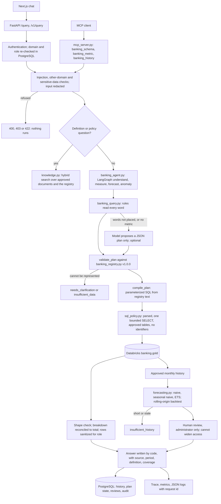
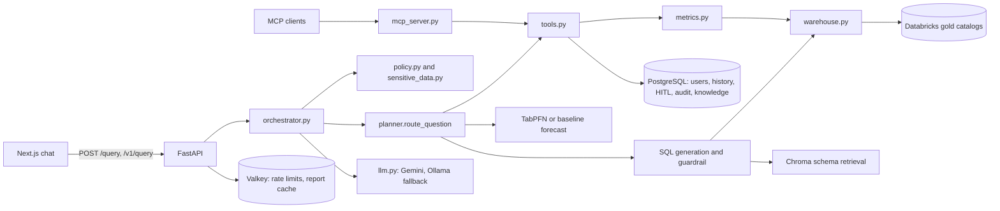
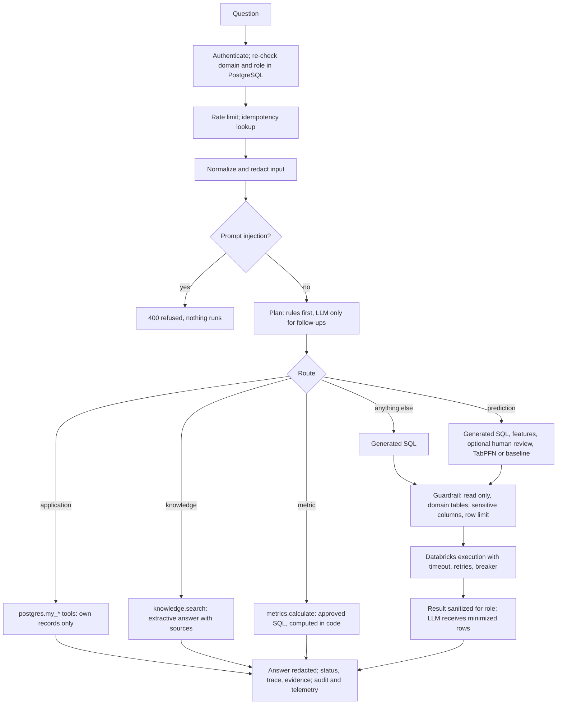

# Ask AI architecture

Ask AI answers business questions from governed sources. Workflow code decides where a question goes and what may run. The LLM only plans follow-ups, drafts SQL and words answers; every number it mentions must come from a validated query.

## Banking workflow

Banking is the validated domain. Finance, healthcare, insurance and retail stay on the general path below and have **not** had the same production validation.

The optional Valkey cache holds rate limits and report data, never answers. It is off in this environment.

The language model never writes the answer and never writes banking SQL by default. `BANKING_GENERATED_SQL` is off because the models tried here produced valid SQL that answered the wrong question. See `docs/BANKING_REPORT.md`.

## Approved metric registries for the other four domains

Finance, insurance, retail and healthcare questions are answered first from approved registries in
`services/domain_registries.py`, by the same planner, compiler, SQL policy and result checks as
banking. Every definition reuses one the dashboards or reports already used. A question a registry
cannot represent cleanly is left to the previous path, so nothing answered before is lost;
`REGISTRY_GENERATED_SQL=false` refuses those instead of generating SQL. Healthcare runs only in the
tenant's mapped catalog, and diagnoses are excluded because existing redaction masks them.
Accuracy on real data: `python -m evals.run_registry_eval`.

## Plans and AI usage

Plans, credits and provider usage are described in `docs/SUBSCRIPTIONS.md`. A plan limits AI consumption and never affects domain access.

## Components

## Request flow

## The seven layers

| Layer | Implementation | Not implemented |
|---|---|---|
| 1 Orchestration | `planner.route_question`, `orchestrator._answer_from_route`, LangGraph plan and retrieve steps | Combining PostgreSQL and Databricks results beyond a metric plus its definition |
| 2 Tool contracts | `services/tools.py`: versioned, strict pydantic arguments, role check, structured errors, trace step | Generated SQL and model inference are orchestrator nodes, not tools |
| 3 Governed RAG | `services/knowledge.py`: versions, content hash, domain filter, confidence threshold, injection scan at ingestion and retrieval, stale flag, citations | Banking uses hybrid keyword and embedding search; other domains are lexical. No reranking. No document approval UI |
| 4 Reliability | `services/reliability.py`: bounded retries with jitter, circuit breakers, bulkheads, request deadline. Applied in `llm.py` and `warehouse.py`. Degradation: Gemini to Ollama, TabPFN to baseline, schema retrieval to keywords, Valkey to local counters | Idempotency and local rate limit counters are per process. No durable job queue |
| 5 Security | `sensitive_data.py`, `policy.py`, SQL guardrail, RBAC checked per request, rate limits, audit events, `purge_history.py` | Injection detection is pattern based and will not catch everything. Database roles are not least privilege |
| 6 Evaluation and HITL | `evals/`, `hitl_reviews` with approve, reject, resume; per-stage trace with latency, retries, tokens | No scheduled evaluation. No token cost attribution |
| 7 Production engineering | `/ready`, `/metrics`, JSON logs with a redacting filter, `/v1/query`, CI workflow, runbook | OpenTelemetry (request ids instead) and deployment manifests. Alembic and a load test now exist; CI has never run |

## Tool contracts (version 1)

| Tool | Arguments | Source | Roles |
|---|---|---|---|
| `postgres.my_access` | none | PostgreSQL, own grants and requests | admin, analyst |
| `postgres.my_conversations` | `limit` | PostgreSQL, own conversations | admin, analyst |
| `postgres.my_reviews` | `limit` | PostgreSQL, own HITL reviews | admin, analyst |
| `metadata.tables` | none | Schema metadata for the session domain, sensitive columns removed | admin, analyst |
| `metrics.calculate` | `question` | Databricks, approved metric SQL for the session domain | admin, analyst |
| `knowledge.search` | `query`, `limit` | Approved documents, metric registry, glossary for the session domain | admin, analyst |

The username and domain always come from the verified session, never from arguments. Extra arguments are rejected, so a caller cannot ask for another user's records.

## Metrics

Definitions live in `services/metrics.py`. Only columns verified against Unity Catalog are used.

- **Loss ratio is refused.** The source has no earned premium or reserves, and the organization has not confirmed the formula.
- **Approved claims to written premium** is available and labelled as not being a loss ratio. It compares claims with policies by different dates, so it can exceed 100%.
- To add a metric: add a `_metric(...)` entry, put it before any metric whose alias also matches its name, verify its value by hand, and add an evaluation case.

## Design decisions

**Deterministic workflow, not autonomous agents.** The router and tools are ordinary code. Agents that choose their own steps would make authorization and audit harder to reason about, and these question types do not need it.

**Vectors in PostgreSQL rows; pgvector and Qdrant not adopted.** The banking corpus is a few short documents, so embeddings are stored as JSON on `knowledge_chunks` and compared in application code. pgvector is not installed on the PostgreSQL 18 server, so it has not been evaluated live. Prefer it over Qdrant if the corpus grows, because it keeps permissions and backup in one database. Schema retrieval stays on Chroma.

**Valkey for rate limits and report cache, not for answers.** Sharing cached answers risks crossing role and domain boundaries and serving stale figures. Rate limits fall back to per-process counters when Valkey is down, which means the effective limit is multiplied by the number of API processes during an outage.

**MCP goes through the same banking workflow.** `mcp_server.py` uses the caller's token and the same plan, policy and redaction code, so it has no separate data access. It is tested with a real client over stdio. `ask_business`, which can reach generated SQL, is off unless `MCP_ALLOW_GENERATED_SQL=true`.

**Baseline forecast as fallback.** TabPFN's default weights are distributed under a non-commercial license and could not be downloaded here, so it has not been run on real data. The baseline picks the lowest backtest error among last value, linear trend and same month last year, and answers name the model used. A baseline-versus-TabPFN comparison remains open until weights are available and the license is decided. Banking uses `services/forecasting.py` instead, with ETS and simple baselines, and TabPFN stays disabled there.

**No LangGraph checkpointer.** Human review state is persisted in `hitl_reviews`, and resuming re-runs validated steps. A checkpointer would add a second source of truth.

**Alembic alongside `ensure_schema`.** Revisions `0001` (baseline) and `0002` (banking workflow) were tested on a restored copy of the real database. The real database has not been stamped; the runbook has the steps.

**Correlation ids, not OpenTelemetry.** Every log line and trace carries a request id, which answers the questions asked so far. Adopt OpenTelemetry when there is a collector to send to; nothing here has been tested against one.
