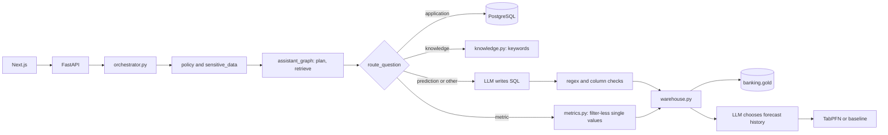

# Banking domain: current-state audit

Audit of branch `feature/agentic_ai_mode` on 2026-11-02, before the banking work. Figures were read from Unity Catalog `banking` and local PostgreSQL. Aggregates only; no customer or account values are recorded here.

## Urgent findings

| Severity | Finding | Status |
|---|---|---|
| High | The repository is **public**. Commit `136ec57`, on `origin/feature/agent_development`, tracks a PostgreSQL dump (`backend/ai_analytics_before_healthcare_fix.backup`) containing 4 users with password hashes and 163 refresh-token rows. The user emails are `example.com` and the business tables in it are empty. | Open: needs a history rewrite and token/password review, which only the owner can decide |
| High | The same commit tracks `.bak` copies of source files and a `backup_finance_*` folder. | Open: remove in the same clean-up |
| High | A string matching a Databricks token format is in `.env.example` history (commits `1b11a2e`, `4a79d4d`). It differs from the current token and those commits are not on any remote branch. | Open: revoke it if it was real |
| High | Databricks connects with a personal owner account. No column masks or row filters exist on `banking`. Only application code protects sensitive columns. | Open: see `docs/sql/banking_least_privilege.sql` |
| Critical | Next.js had an unauthenticated remote code execution advisory in the Image Optimization API. | Fixed: 15.5.28 through `npm audit fix` |
| Medium | Python dependencies had known advisories, including starlette and python-multipart. | Mostly fixed: see the implementation report |
| Medium | The local PostgreSQL password is short and appears in tracked documentation. | Open: rotate if it is used beyond local development |

## Test baseline

Before any change: 285 passed, 6 failed, 5 skipped. The six were reviewed individually:

| Test | Cause | Resolution |
|---|---|---|
| `test_healthcare...authoritative_tenant` | Read `WAREHOUSE=databricks` from the local `.env` | Passes once tests ignore `.env` |
| `test_llm...cloud_keys_are_missing` | Read a real `GOOGLE_API_KEY` from `.env` | As above |
| `test_sensitive_sql_generation` (3 tests) | SQL dialect came from `.env` | As above |
| `test_schema_rag...stale_chroma_id` | Test expected an older recovery sequence; the code recovers correctly | Test updated to assert the recovery that happens |

The suite was also reading the developer's `.env`, so it could reach real services. `tests/conftest.py` now runs it from an empty directory.

## Banking data inventory

Catalog `banking`, schema `gold`: 44 tables. `finance` also maps to this catalog.

| Table | Rows | Business date | Coverage | Usable history |
|---|---|---|---|---|
| `gold_transactions` | 100,011 | `txn_timestamp` (DATE) | **2026-03-15 only** | None |
| `gold_accounts` | 8,000 | `open_date` | 2010-01-02 to 2026-06-06 | 197 complete months of openings |
| `gold_customers` | 5,000 | `onboarding_date` | 2010-01-01 to 2025-11-18 | 190 complete months |
| `gold_loan_repayments` | 39,570 | `due_date` | 2024-01-31 to 2026-03-15 | 26 complete months |
| `gold_loans` | 2,000 | `disbursement_date` | 2024-01-01 to 2025-02-04 | 13 complete months, ended |
| `gold_cards` | 6,000 | `issue_date` | 2018-01-01 to 2023-06-24 | 65 complete months, ended |
| `gold_branches` | 20 | none | snapshot | none |

The rest are `agg_*`, `summary_*`, `snapshot_*`, `dim_*`, `fact_*` and pipeline tables (`gold_metadata`, `gold_table_profile`, `gold_column_profile`, `gold_load_summary`, `gold_data_quality`).

### What this means for the demonstration

**Transactions cover a single business day.** Bronze holds `txn_timestamp` as a string from 00:00 to 23:59 on 2026-03-15; silver stores a date. This is a one-day extract, not a pipeline fault. So daily, weekly and monthly transaction trends, period-over-period transaction comparisons and transaction forecasts cannot be produced from this data. Trend and forecast demonstrations use repayments and account openings. A multi-month transaction extract would be needed for the rest.

### Data-quality facts

- `transaction volume` of 251,829,230.04 includes 12,759,030.40 FAILED and 5,009,478.97 PENDING. SUCCESS alone is 234,060,720.67. **A business decision is needed on the default.** Answers state what is included.
- 60 negative transaction amounts; 30 transactions with no matching account; 1 at or above INR 100,000.
- 15 accounts with no balance; 25 accounts whose customer is missing; 15 customers with no ID; 20 future dates of birth.
- All 2,000 loans are ACTIVE, so NPA and default rates cannot be derived.
- From 2025-07, 2,525 instalments have `amount_paid = 0`, with collections falling below amounts due.
- Bronze holds 100,211 transactions and silver 100,011; the reason for the 200 removed is not recorded.
- `agg_accounts_monthly.total_balance` is today's balance of accounts opened that month, not a balance history. "Total balance last year" cannot be answered.
- `summary_transactions` holds one row per account. A model previously reported one of its rows as a grand total.

## Architecture before this work

## Reproduced failures

- **Forecasting.** The model wrote the history query and often fetched only the latest month, for example `WHERE _gold_month = (SELECT MAX(_gold_month) ...)`, so a forecast had one row to work from.
- **Retail SQL generation.** Ollama aborted with `prediction aborted, token repeat limit reached` in the runs where the error was captured.
- **Generated SQL in general.** See the implementation report: valid SQL that answers the wrong question is the main problem, and validation cannot detect it.

## File-by-file gap analysis

| File | Had | Gap | Action |
|---|---|---|---|
| `services/metrics.py` | 6 single-value metrics, 1 banking | No dimensions, filters, trends, versions | Kept for other domains; banking gets a registry |
| `services/planner.py` | Rule and LLM intent | No structured query plan | Kept; banking plans separately |
| `services/assistant_graph.py` | LangGraph plan, retrieve | Not a governed workflow | Kept; new banking graph |
| `services/sql_generator.py` | LLM SQL with templates | Unreliable | Kept, gated off for banking |
| `services/guardrail.py` | Regex read-only check | Not parser based | Kept; parsed policy added on top |
| `services/orchestrator.py` | Main flow | No banking workflow; refusals needed the warehouse | Hook added; checks reordered |
| `services/baseline_forecast.py` | Next-period baseline | No multi-step backtest, ETS or history checks | Kept for other domains; new service for banking |
| `services/tabpfn_service.py` | Estimators | Weights absent, license unresolved | Kept; disabled for banking |
| `services/knowledge.py` | Keyword search | No embeddings or banking corpus | Extended |
| `services/tools.py` | Six governed tools | Adequate | Kept |
| `mcp_server.py` | Tools, tested with fakes | No real transport test; generated SQL exposed | Rewritten over the banking workflow |
| `services/reliability.py` | Retries, breakers, deadlines | Adequate | Reused |
| `sensitive_data.py` | Redaction and guards | `account_id` in a join was blocked for analysts; "salary accounts" refused | Added a compiled-SQL guard; refined pattern |
| `services/observability.py` | Metrics and logs | No correlation id in logs | Added |
| `seed.py`, `models.py` | `ensure_schema` | No migration versioning | Alembic added alongside |
| `main.py` | `/ready` | Stayed 503 after an outage until a restart | Background retry added |
| `.github/workflows/ci.yml` | Written, never run | Deselected tests, no Valkey | Deselects removed, Valkey added; still not run |

## Phased plan

1. Test isolation and audit.
2. Metric registry, query planner, compiler, parsed SQL policy.
3. LangGraph banking workflow with verification and evidence.
4. Forecast service with approved history.
5. Follow-up state, human review, outage behaviour.
6. Model comparison, generated-SQL evaluation, TabPFN adapter and report.
7. RAG corpus and embeddings, real MCP tests, Alembic.
8. Security scans, backup validation, load test, demonstration, documentation.
