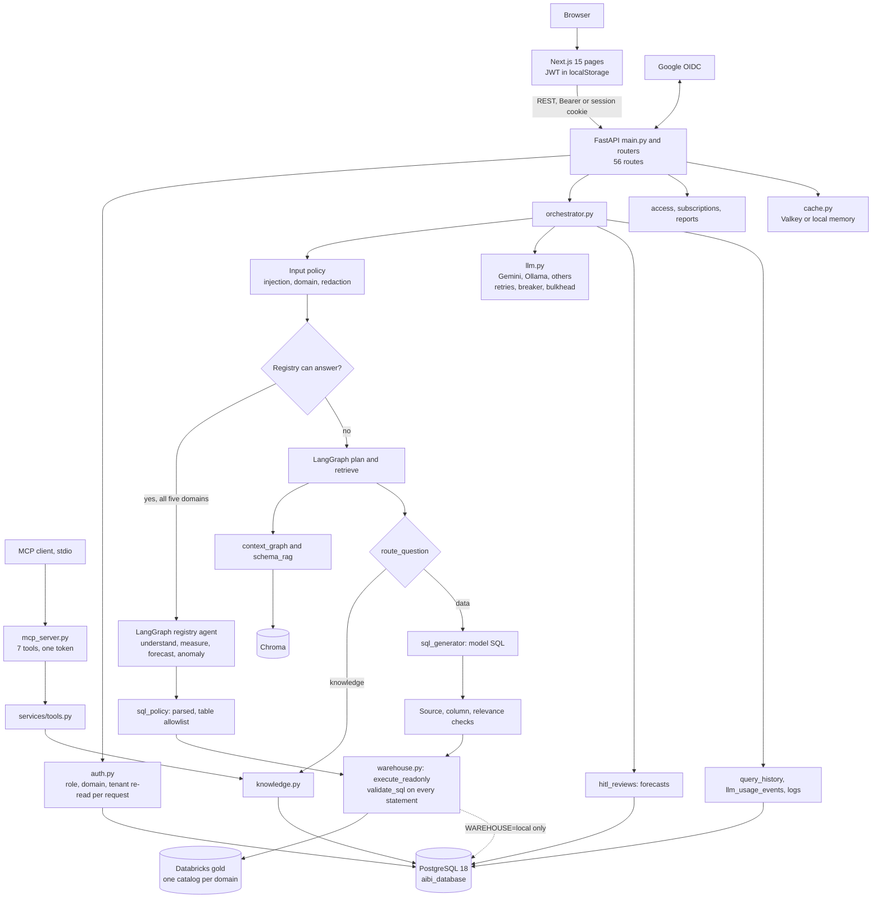

# Ryze Infinity: current architecture

State on 2026-11-11, branch `feature/agentic_ai_mode`, including uncommitted work.

## Diagram

## Structure

| Area | Location | Notes |
|---|---|---|
| Frontend | `frontend/app`, `components`, `lib/api.ts` | 14 pages, 11 shared components, one small API client. Three files still call `fetch` directly |
| API | `backend/app/main.py`, `access_api.py`, `subscription_api.py` | Main file holds 27 routes and much of their logic |
| Authentication | `backend/app/auth.py`, `security.py` | PBKDF2 passwords, HS256 JWT, Authlib OIDC |
| Orchestration | `services/orchestrator.py`, `assistant_graph.py`, `banking_agent.py`, `planner.py` | Procedural core with two graphs |
| Metrics | `services/banking_registry.py`, `banking_query.py`, `domain_registries.py`, `metrics.py` | Registry, compiler, parser |
| SQL safety | `services/guardrail.py`, `sql_policy.py`, `sensitive_data.py`, `tenant_scope.py` | |
| Data access | `warehouse.py`, `db.py`, `models.py`, `cache.py` | `services/warehouse.py` is unused and has two undefined names |
| Forecasting | `services/forecasting.py`, `baseline_forecast.py`, `tabpfn_service.py`, `feature_builder.py` | |
| Billing | `services/subscriptions.py`, `payments.py`, `subscription_api.py` | Mock payment gateway |
| Evaluation | `backend/evals` | Offline, SQL, RAG, registry, banking, load, demo |
| Tests | `backend/tests` | 40 test files |

## Routes

Every data route requires `get_current_user`. `/admin/*` requires `require_admin`.

| Access | Routes |
|---|---|
| Public by design | `/health`, `/ready`, `/auth/domains`, `/auth/login`, `/auth/signup`, `/auth/logout`, `/auth/oidc/*` |
| Token or administrator | `/metrics` |
| Signed-in user | `/query`, `/v1/query`, `/dashboard`, `/reports`, `/monitor`, `/prompts`, `/history`, `/history/{id}/replay`, `/hitl`, `/hitl/{id}/resume`, `/hitl/{id}/{action}`, `/me`, `/warehouse/check`, `/warehouse/verify`, `/context`, `/tabpfn/diagnostics`, `/auth/switch-domain`, `/access/*`, `/subscription/*`, `/billing/*` |
| Administrator | `/admin/*` |

Only `/query` also has a `/v1/` form. There is no general API versioning.

## Configuration

| Setting | Value here |
|---|---|
| `WAREHOUSE` | `databricks` |
| Domain catalogs | banking, finance, insurance, retail and healthcare each map to their own catalog, schema `gold` |
| Healthcare tenant catalogs | Configured |
| `LLM_PROVIDER`, fallback | `google`, `ollama` |
| `DEMO_MODE` | `true` |
| `CACHE_URL` | Not set |
| `METRIC_REGISTRY_DOMAINS` | finance, insurance, retail, healthcare |
| `REGISTRY_GENERATED_SQL` | `true` |
| `BANKING_GENERATED_SQL`, `MCP_ALLOW_GENERATED_SQL` | `false` |
| `SUBSCRIPTIONS_ENABLED`, `SUBSCRIPTION_ENFORCEMENT` | `true` |

Services observed on this machine: PostgreSQL, Ollama, API on 8013 and web on 3000 running. Valkey not running. Docker not installed.

## Dependencies

| Issue | Detail |
|---|---|
| Undeclared | `google-genai` is installed and required for Gemini, but absent from `requirements.txt`. A clean install, including CI, would lose the configured provider |
| No imports found | `sse-starlette`, `passlib` |
| Test tool in runtime list | `pytest` |
| Known conflict | `python-jose` limits `pyasn1` to below 0.5 |
| Versions | Python 3.13, FastAPI 0.162, SQLAlchemy 2.0.40, LangGraph 1.2.14, Next.js 15, React 19 |

## Tests and evaluation

| Check | Latest result | Meaning |
|---|---|---|
| Backend suite | 527 passed, 0 failed, 9 skipped | Mostly fakes and temporary databases |
| TypeScript | Clean, run during this audit | |
| Offline evaluation | 20/20 | Fakes |
| Registry evaluation, live | 35/35, earlier on this branch | Real Databricks; deterministic path |
| Banking evaluation, live | 62/62, earlier on this branch | Real Databricks; deterministic path |
| Skipped | 3 analytics, 2 workflow, 3 cache, 1 MCP | Need live services and flags |
| Frontend tests | None | |
| Load tests | `evals/load_test.py` exists | Not run in this audit |
