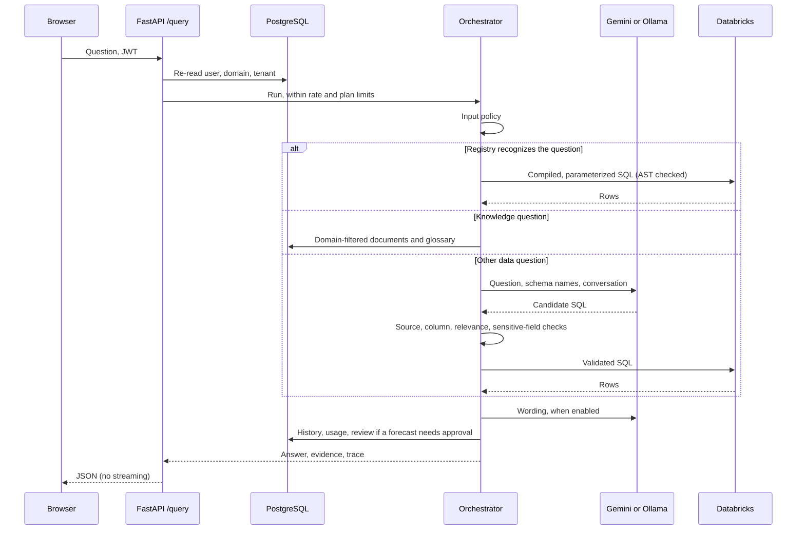

# Ryze Infinity: data flow and database assessment

Audited 2026-11-11. PostgreSQL was read in read-only transactions: names and counts only, no row values. Databricks figures are from 2026-11-09.

## Ask AI today

## What may leave the system

| Destination | What is sent |
|---|---|
| Gemini | Question, schema names, conversation context and, depending on the step, values needed for wording |
| Ollama (local) | The same, and embeddings text |
| Databricks | Validated SQL and bound parameters |

## PostgreSQL `aibi_database`

Server 18.6. Only extension: `plpgsql`. `pgvector` is not available. Row-level security is on no table. 29 foreign keys, none crossing schemas. Alembic has not stamped this database.

| Schema | Tables | Rows | Used by the application? |
|---|---|---|---|
| `public`: application | Users, grants, tenants, conversations, history, reviews, knowledge, subscriptions, usage, audit | 750 messages, 363 conversations, 375 queries, 9 users | Yes. `public` has 40 tables, and the models define 40 |
| `public`: domain tables | `customers`, `accounts`, `transactions`, `loans`, `claims`, `orders`, `order_items`, `products`, `healthcare_*` | 320 customers, 1,790 orders, 80 patients | Only with `WAREHOUSE=local` |
| `banking` | 7 bank tables, dated names | About 60,700 | No references found |
| `finance` | 5 | About 9,700 | No references found |
| `healthcare` | 5 | About 28,800 | No references found |
| `insurance` | 1 | 60 | No references found |
| `retail` | 4 | About 96,800 | No references found |
| `ryze_banking` | 5 | 0 | No references found |

Facts worth noting:

- Row-count statistics in PostgreSQL report 0 for most tables. Exact counts were used instead, which means statistics are stale, so the planner has poor information.
- `user_domain_grants` has 0 rows. Current access comes from `app_users.domain`.
- `llm_usage_events` and `usage_transactions` have 0 rows, although the recording code is wired in. One real model request must confirm that it saves.
- `query_history` has no Healthcare rows: Banking 321, Insurance 21, Retail 18, Finance 15.
- The side schemas look like imported copies of source data. They must not be changed or removed without a decision on their purpose.

## Databricks (2026-11-09)

| Domain | Catalog | Gold tables | Tenant column |
|---|---|---|---|
| Banking | `banking` | 44 | n/a |
| Finance | `finance` | 38 | n/a |
| Insurance | `insurance` | 32 | n/a |
| Retail | `retail` | 47 | n/a |
| Healthcare | `healthcare`, plus tenant catalogs | 47 | None; isolation is by catalog |

No table or column descriptions and no key constraints were measured in Banking, Insurance, Retail or Healthcare. Finance was not measured. Banking transactions covered one day, 2026-03-15.

## PostgreSQL and Databricks connection

The two are not connected and don't need to be. The API talks to each one separately. The brief's rule against bulk synchronization matches this design.

## Routing today and proposed

| Question or data | Today | Proposed source and reason |
|---|---|---|
| Registered metric | Databricks | Databricks: declared on the metric |
| Metric with no definition | Model SQL or refusal | Controlled generation if allowed, otherwise refusal |
| Business definition or policy | PostgreSQL knowledge | Knowledge retrieval with citations |
| Mixed: number and explanation | Partially | SQL for the number, documents for the context |
| Users, grants, history, usage, audit | PostgreSQL | PostgreSQL: system of record |
| Dashboards | Databricks when `WAREHOUSE=databricks` | Declared per dashboard |
| Side schemas | Not used | Undecided; see the roadmap |

## Migration needs

Nothing here runs without separate approval, a backup, and a rehearsal on a temporary database. All changes are additive and reversible.

| Change | Purpose | Phase |
|---|---|---|
| Stamp at `0003` | Bring the real database under Alembic | 2 |
| Restricted roles | Least privilege | 3 |
| `tenant_id` on knowledge and audit | Tenant boundaries | 3, 5 |
| Requested action and outcome on reviews | Approval record | 5 |
| Tool audit table | MCP and tool audit | 5 |
| Job table, if the queue needs one | Worker tracking | 6 |
