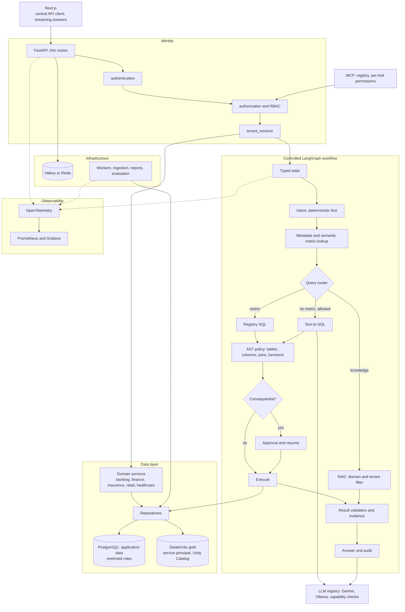

# Ryze Infinity: target architecture

Proposed, not implemented. It extends the current system rather than replacing it. Every API contract stays unless a phase states otherwise and you approve it.

## Diagram

## Design rules

1. **Deterministic first.** A model is used only for unmapped questions, drafting and wording. The registry already answers measured questions correctly, and model-written SQL has measured poorly.
2. **LangGraph controls, but does not multiply.** Nodes are functions with typed input and output. No autonomous agents. Retries are bounded, and each node records its step.
3. **The router decides by declared facts.** Each metric declares its source. Priority: metric definition, domain, authoritative source, freshness, complexity. A question with no declared source falls to controlled generation or a refusal, never a guess.
4. **One SQL policy for every path.** One AST validator receives the domain's table, column, join and function rules, and checks every statement.
5. **Credentials separate reading from writing.** Analytics never run with an account that can write.
6. **Domain and tenant remain separate.** Authorization checks both at the API, service and repository boundaries.
7. **Internal nodes call services directly.** MCP is the external face over the same registry and rules.
8. **Vector storage is an interface.** Chroma stays the default. pgvector can be added when the server has it.
9. **Modular monolith.** Modules talk through services. Workers are the first thing that could be separated, and no microservices are proposed now.

## Module map

The brief's layout, with where each existing module goes. **Additions** are places the brief's tree does not list but existing code needs.

| Target | Comes from |
|---|---|
| `core/config.py`, `security.py`, `exceptions.py` | `config.py`, `security.py`, `GuardrailError` |
| `core/logging.py` | Logging parts of `observability.py` and `main.py` |
| `core/dependencies.py` | New: shared FastAPI dependencies |
| `core/reliability.py`, `core/cache.py` (additions) | `services/reliability.py`, `cache.py` |
| `identity/authentication.py` | Tokens, login, registration and OIDC from `auth.py` |
| `identity/authorization.py` | `get_current_user`, domain access, `services/access.py` |
| `identity/rbac.py` | `require_admin`, `is_admin_account` |
| `identity/tenant_resolver.py` | `_tenant_assignment`, `services/tenant_scope.py` |
| `domains/<domain>/` | Each domain's registry and prompts from `domains.py`, `banking_registry.py`, `domain_registries.py` |
| `dashboard/`, `reports/` | Dashboard code from `orchestrator.py`; `services/reports.py` |
| `ai/orchestration/` | `orchestrator.py`, `assistant_graph.py`, `banking_agent.py`, `synthesis.py` |
| `ai/routing/` | `planner.py` |
| `ai/llm/` | `llm.py`, split into a registry and adapters |
| `ai/rag/` | `knowledge.py`, `schema_rag.py`, `conversation_context.py` |
| `ai/mcp/` | `mcp_server.py`, `services/tools.py` |
| `ai/guardrails/` | `guardrail.py`, `sql_policy.py`, `policy.py`, `sensitive_data.py` |
| `ai/text_to_sql/` | `sql_generator.py` |
| `ai/evaluation/` | Entry points to `backend/evals`, which stays in place |
| `ai/forecasting/` (addition) | `forecasting.py`, `baseline_forecast.py`, `feature_builder.py`, `tabpfn_service.py` |
| `data/postgres/` | `db.py`, `models.py`, `seed.py`, new repositories |
| `data/databricks/` | `warehouse.py` |
| `data/metadata/` | `context_graph.py`, `services/warehouse.py` (kept until proven obsolete) |
| `data/semantic_layer/` | `banking_query.py`, `metrics.py` |
| `data/query_router/` | New |
| `governance/audit.py`, `approvals.py`, `policies.py` | Audit from `observability.py`; HITL from `main.py`; policy rules |
| `governance/lineage.py` (addition) | `governance.py` |
| `billing/usage.py`, `token_tracking.py`, `payments.py` (addition) | `services/subscriptions.py`, `payments.py` |
| `integrations/` | Empty until there is one |
| `backend/workers/` | New in Phase 6 |
| `api/` (addition) | `access_api.py`, `subscription_api.py`, `schemas.py` and routes moved out of `main.py` |

`uvicorn app.main:app` remains the entry point.

## Data responsibilities

| System | Holds | Rule |
|---|---|---|
| PostgreSQL | Users, grants, tenants, conversations, usage, audit, approvals, knowledge | Application account has no superuser rights. Any analytical reader uses `analytics_user` or similar, with `SELECT` on named tables |
| Databricks | Curated gold tables, metrics, history | Service principal with `SELECT` on approved gold objects only |
| Vector store | Schema and knowledge embeddings | Replaceable; always filtered by domain, and by tenant where it applies |
| Valkey or Redis | Cache, rate limits, job broker | Holds nothing that cannot be rebuilt |

No Databricks table is copied into PostgreSQL by default.

## Providers

| Task | Primary | Controlled fallback |
|---|---|---|
| Conversation, wording | Gemini | Ollama `llama3.2` |
| SQL generation | Gemini | None. Local `llama3.2` scored 0/10 in the banking evaluation |
| Embeddings | Ollama `nomic-embed-text` | None; changing the model requires re-indexing |
| Document processing, images | Depends on a verified capability entry | None until tested |

A fallback runs only when the capability registry says the model can do the task and the data-handling policy allows that provider for the domain.

## Deployment

Docker images for frontend, backend and worker. Compose for local integration with PostgreSQL 18 and Valkey. Environment validation at startup, separate liveness and readiness, and configuration per environment. Kubernetes is not proposed; nothing here yet justifies it.
